# User manual

This manual is for the people who use **eQwik YardHRMS™** day to day, and for Qwik Business Solutions™ staff
who use the **Qwik Licence & Subscription Manager**. It is organised by task and by role. Screenshots
show the synthetic demo company "Blue Mountain Traders"; your screens show your own company name, logo
and only the menu items your role allows.

> **Before you pay anyone.** Until your payroll specialist has signed off the statutory rules, every
> payroll run and payslip shows **Not certified for live payroll**. Do not use those figures for real
> salary payments or statutory filings until the banner is gone.

Contents

- Part A — eQwik YardHRMS (companies)
  1. [Roles at a glance](#1-roles-at-a-glance)
  2. [Signing in and your account](#2-signing-in-and-your-account)
  3. [First-time company setup (Company Administrator)](#3-first-time-company-setup-company-administrator)
  4. [The dashboard and notifications](#4-the-dashboard-and-notifications)
  5. [Employees (HR)](#5-employees-hr)
  6. [Leave](#6-leave)
  7. [Timesheets and overtime](#7-timesheets-and-overtime)
  8. [Payroll setup (Payroll Officer / Finance Approver)](#8-payroll-setup-payroll-officer--finance-approver)
  9. [Running payroll](#9-running-payroll)
  10. [Payslips](#10-payslips)
  11. [Reports, bulk imports and the audit log](#11-reports-bulk-imports-and-the-audit-log)
  12. [Users and roles](#12-users-and-roles)
  13. [Subscription and billing documents](#13-subscription-and-billing-documents)
  14. [Data & privacy](#14-data--privacy)
  15. [Employee self-service quick guide](#15-employee-self-service-quick-guide)
  16. [Manager quick guide](#16-manager-quick-guide)
- Part B — Qwik Licence & Subscription Manager (Qwik staff)
  17. [Signing in and roles](#17-signing-in-and-roles)
  18. [Plans and customers](#18-plans-and-customers)
  19. [Invoices and manual payments](#19-invoices-and-manual-payments)
  20. [Subscriptions, activation codes and renewals](#20-subscriptions-activation-codes-and-renewals)
  21. [Usage, audit, staff and account support](#21-usage-audit-staff-and-account-support)
  22. [Account closures and legal holds](#22-account-closures-and-legal-holds)
- [Glossary](#glossary) · [Getting help](#getting-help)

---

# Part A — eQwik YardHRMS

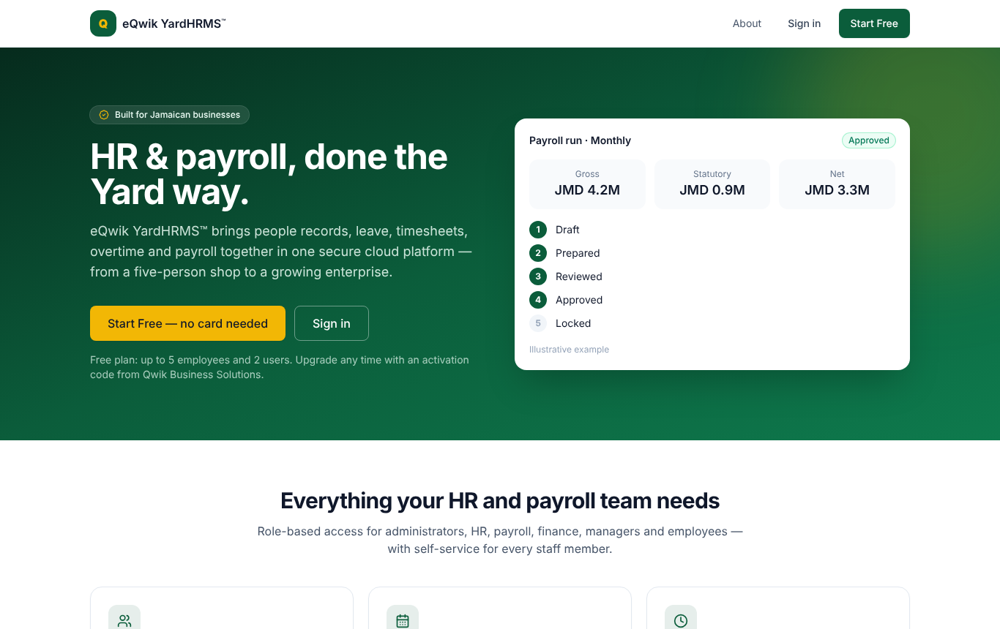

## 1. Roles at a glance

Your company administrator gives you one or more roles. Menu items you cannot use are hidden.

| Role | What you do | Two-step verification (MFA) |
|---|---|---|
| **Company Administrator** | Everything in the company: settings, users, subscription, data & privacy | Required |
| **HR Officer** | Employees, leave, timesheets, overtime, HR reports | Optional |
| **Payroll Officer** | Payroll setup, prepares payroll runs, timesheets/overtime on behalf, payslips | Required |
| **Finance Approver** | Reviews, approves and locks payroll; approves statutory rule versions | Required |
| **Manager / Supervisor** | Team leave, timesheets and overtime (enter on behalf and approve), payslip printing | Optional |
| **Employee** | Own profile, leave, timesheets (weekly/fortnightly staff), overtime, payslips | Optional |

Some features depend on your plan: **Free** covers employees, leave and timesheets for up to 5 active
employees and 2 users; payroll, payslips, bulk imports, advanced reports and the audit log come with paid
plans (see [pricing](pricing.md)).

## 2. Signing in and your account

**Sign in.** Go to your company's YardHRMS address, choose **Sign in**, enter your email and password.
If your organisation has enabled it you can use **Continue with Google** or **Continue with Microsoft**
instead (your account must already exist — see below).

**Two-step verification (MFA).** The first time you sign in with an administrator, payroll or finance
role you are asked to set up an authenticator app (Google Authenticator, Microsoft Authenticator,
1Password, …): scan the QR code, then type the 6-digit code. After that, enter the current code at each
sign-in.

**More than one company?** Pick the organisation after sign-in, or switch from the user menu (top right).
The company you are working in is always shown in the sidebar and header.

**Forgot your password?** Use *Forgot password?* on the sign-in page; the reset link arrives by email and
expires. **Lost your authenticator?** Ask your Company Administrator to reset your MFA (§12); if you are
the only administrator, contact Qwik support.

**Account & security** (user menu → *Account & security*):

- **Change password** — signs out your other sessions.
- **Two-step verification** — status and enrolment.
- **Notifications** — choose which email categories you receive (approvals, decisions, payroll,
  payslips). Subscription notices to administrators cannot be turned off.
- **Single sign-on** — link or unlink Google/Microsoft. Microsoft work accounts sometimes need linking
  here once (sign in with your password first, then *Link Microsoft*).

**Accepting an invitation.** Open the link in the invitation email, set your password (or continue with
Google/Microsoft using the invited email address) and you are in.

Sessions end after 30 minutes of inactivity or 12 hours in total (your provider may set other limits).

## 3. First-time company setup (Company Administrator)

1. **Register** — on the landing page choose **Start Free**: legal and display name, your name, work
   email and password; accept the licence. Click the verification link in your email.
2. **Sign in and enrol MFA** (§2).
3. **Company Settings → Profile & branding** — registered and trading names, TRN, NIS/NHT employer
   numbers, address and parish, contacts, logo (PNG/JPEG/WebP) and accent colour. Name and logo appear
   on screens, payslips and reports.
4. **Company Settings → master data tabs** — departments, branches, positions, employment types, shift
   types and **public holidays** (excluded from leave day counts and salary proration).
5. **Leave** — set up leave types and policies (§6).
6. **Employees** — add them one by one (§5) or import them (§11).
7. **Users & Roles** — invite colleagues and give them roles (§12).
8. **Payroll** (paid plans) — complete Payroll Setup (§8) before your first run.
9. **Subscription** — when you are ready for a paid plan, pay Qwik and enter the activation code (§13).

Checklist for a typical small business: profile → departments → public holidays → leave types/policies
→ employees → invite HR, Payroll and Finance users → payroll setup → statutory rules approved → first
payroll run.

## 4. The dashboard and notifications

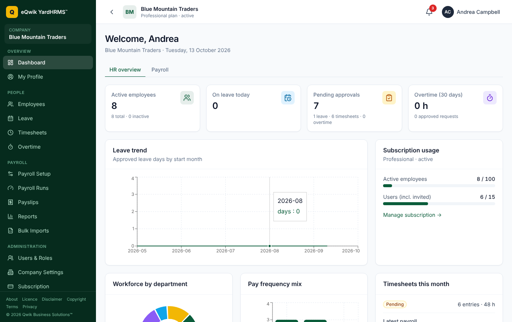

The **Dashboard** adapts to your role: your leave balances and latest payslip, and for HR and
administrators workforce by department, pay-frequency mix, leave trend, timesheets this month and
subscription usage. A warning card appears while statutory payroll is not yet certified.

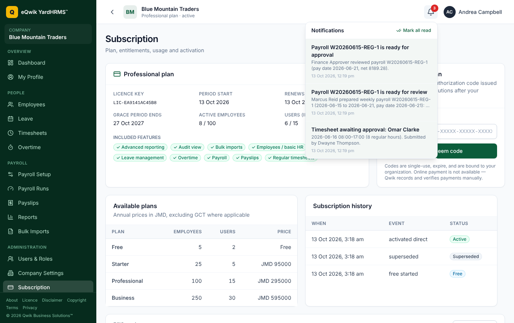

The **bell** in the header lists what needs your attention: requests waiting for your approval,
decisions on requests you submitted, payroll runs ready for review or approval, new payslips, and (for
administrators) subscription reminders 30, 14, 7 and 1 day(s) before expiry. Click an item to open it;
mark items read individually or with **Mark all read**. The same notices are emailed unless you turned that
category off. **Payslips are never attached to emails** — sign in to view them.

## 5. Employees (HR)

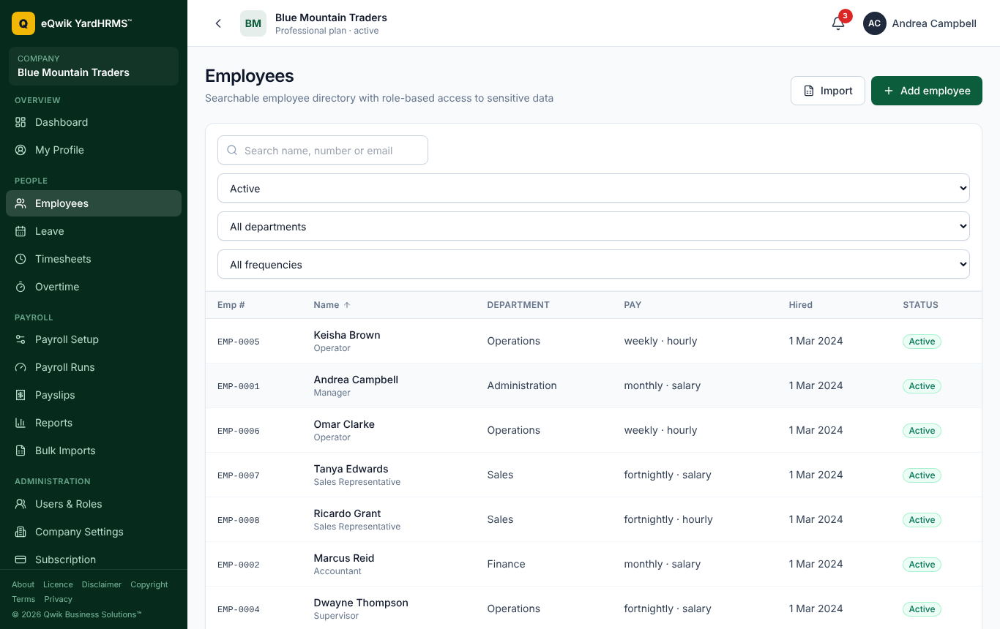

**Add an employee** — *Employees → Add employee*. Required: first and last name, hire date, pay
frequency (weekly, fortnightly or monthly), pay type and either the salary per pay period (salaried) or
the hourly rate (hourly). Monthly employees must be salaried. Leave the employee number blank to have
one generated (`EMP-0001`…).

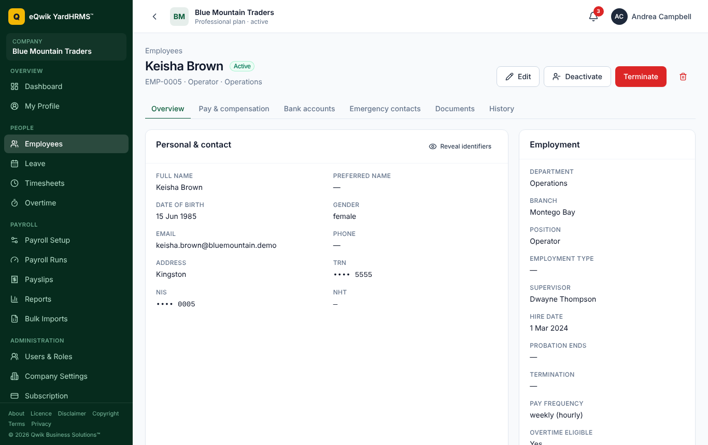

**The employee record** has tabs for personal details, employment, identifiers, emergency contacts,
bank accounts, documents, recurring allowances and deductions (including loans with balances),
compensation and employment history, and leave balances.

- **TRN** (9 digits), **NIS**, **NHT** numbers and **bank accounts** are encrypted and shown masked unless
  your role has the sensitive-data permission.
- **Pay changes** are effective-dated with a reason and kept in history. Personal-data changes are
  recorded in the audit log with before/after values.
- **Documents** (contracts, IDs, certificates) are stored privately; only permitted roles can open them.
- **Leaving the company** — use *Deactivate* or *Terminate*, never delete: history, leave and payslips
  remain. Inactive employees do not count towards your plan limit; reactivating someone does and is
  refused if the plan is full.
- **Linking a user** — to give an employee self-service, invite them as a user and link the employee
  record (§12).

## 6. Leave

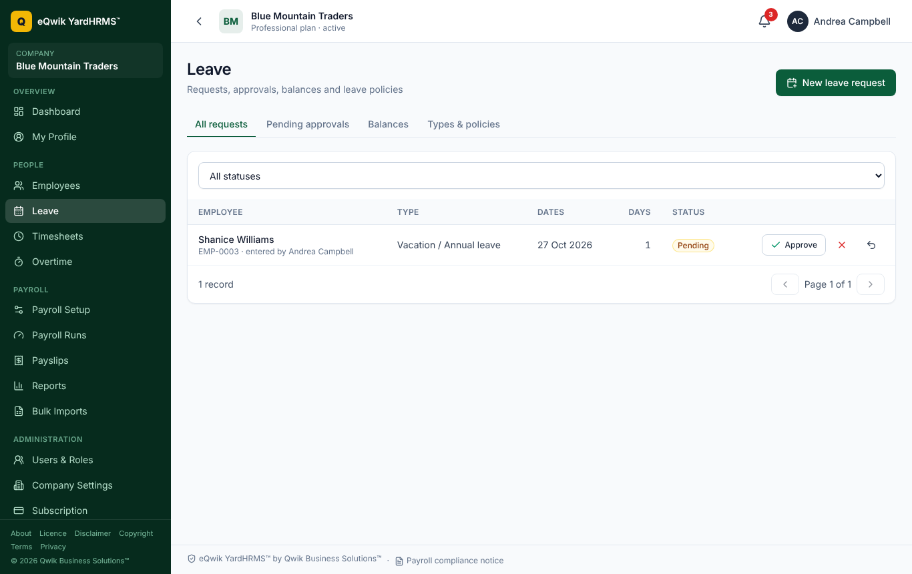

**Set-up (HR Officer / Administrator)** — *Leave → Types & policies*: **Add type** (name, paid percentage, whether
a document is required) and **Add policy**: annual entitlement, accrual method, carry-forward limit and expiry.

**Requesting leave** — *Leave → New leave request*: type, start and end date (tick *Half day at
start/end* where needed),
reason, attachment if required. Working days exclude weekends and public holidays. You see your balance
before submitting.

**On behalf of someone** — HR, Payroll and Managers can record leave for an employee (e.g. a phoned-in
sick day). The record shows both the employee and who entered it.

**Approving** — open the *Pending approvals* tab (or the bell), review the balance and dates, then **Approve** or
**Reject** with a comment. You cannot approve your own request. A pending request can be cancelled by the employee or an
approver.

**Balances** come from a ledger that cannot be edited: opening balances, monthly accruals (automatic),
leave taken, adjustments (with a reason), year-end carry-forward and expiry. Approved unpaid or part-paid
leave reduces pay in the period it falls in.

## 7. Timesheets and overtime

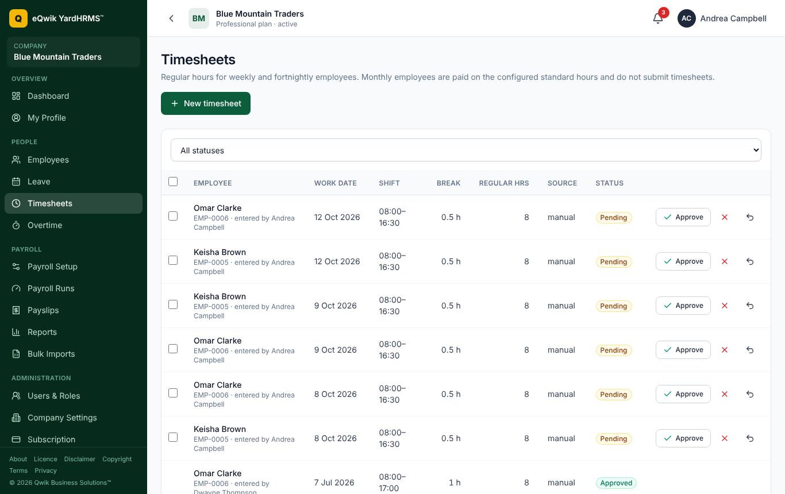

**Who submits timesheets?** Only **weekly and fortnightly** employees. **Monthly employees never submit
regular timesheets** — their pay uses standard hours (173.33 per month by default).

**Entering a timesheet** — *Timesheets → New timesheet*: employee (yourself, or someone you manage), work
date, shift (optional), start and end time (overnight shifts allowed) and break hours. Regular hours are
calculated for you. The system rejects duplicates, overlapping times and dates in a locked pay period.

**Overtime** — *Overtime → New overtime request*: employee (must be overtime-eligible, which can include monthly
staff), date, hours and overtime rule (e.g. time-and-a-half). Overtime is approved separately from
timesheets.

**Approval** — every entry starts **Pending** and must be approved by someone other than the person
who entered it. Tick the rows and use **Approve selected** for bulk approval. Only approved time reaches
payroll.

## 8. Payroll setup (Payroll Officer / Finance Approver)

Read the [payroll configuration & calculation policy](PAYROLL_CALCULATION_POLICY.md) once before you
start. Open **Payroll Setup**.

**Pay frequencies** — standard hours and working days per period, and the **tax-year start** used for
year-to-date (cumulative) calculations.

**Overtime rules** — name and multiplier.

**Allowance & deduction types** — e.g. travel allowance, uniform deduction, staff loan; whether taxable
and whether they reduce statutory income.

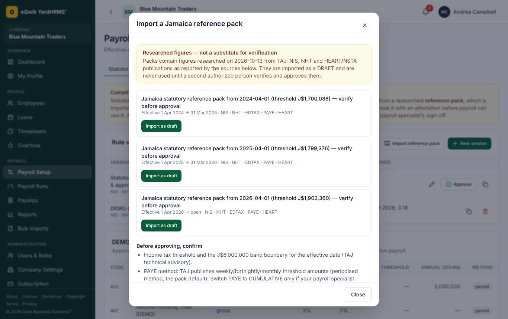

**Statutory rules** (NIS, NHT, Education Tax, PAYE/income tax, HEART/NTA):

1. Choose **Import reference pack** to start from the researched Jamaica figures for a tax year, or
   create a version and enter the values yourself. Imported packs always arrive as **Draft**.
2. For each component the version stores rates, thresholds, ceilings, age limits, the calculation method
   (**per period** or **cumulative year-to-date**) and the source citation.
3. A **different authorised user** (normally the Finance Approver) checks every figure against the
   cited official source and **approves** the version with an attestation. You cannot approve a version
   you created.
4. Payroll cannot be prepared for a period without an approved version that is effective for it. Once
   used by an approved run, a version cannot be changed — create a new version instead.

## 9. Running payroll

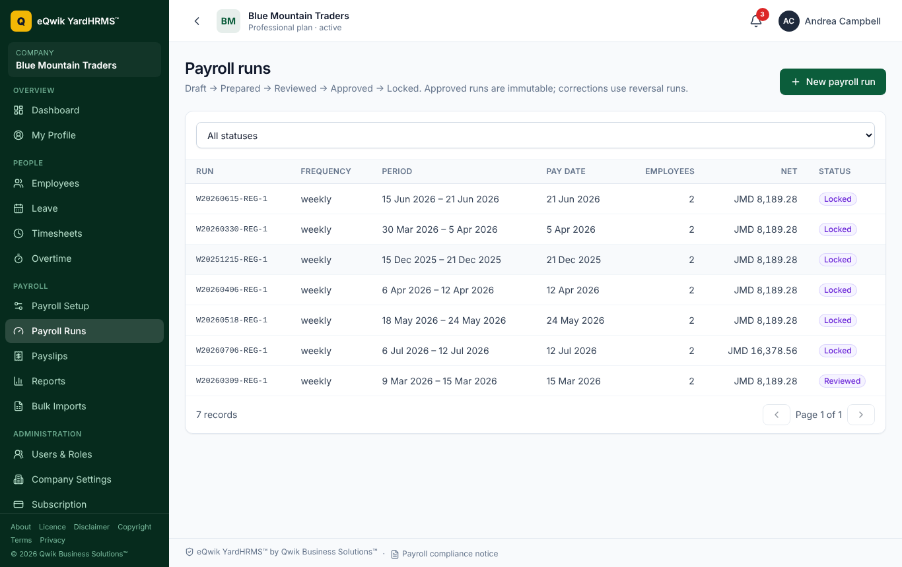

| Step | Who | What |
|---|---|---|
| 1. **Create run** | Payroll Officer | Pay frequency, period start and end, pay date, optional department; or a **supplemental** run (bonus, commission, retro pay, adjustments) |
| 2. **Calculate & prepare** | Payroll Officer | The system gathers salaries, approved time, overtime, leave, allowances, deductions and statutory rules and calculates each employee |
| 3. **Check exceptions** | Payroll Officer | Fix warnings (e.g. unapproved timesheets, missing bank account) and **recalculate** as often as needed |
| 4. **Mark reviewed** | Finance Approver | Must be a different person from the preparer (unless your company switched that rule off) |
| 5. **Approve** | Finance Approver | Freezes the figures and issues payslips to employees |
| 6. **Lock** | Finance Approver | Closes the period: its timesheets, leave and overtime can no longer change |
| 7. **Bank file** | Payroll Officer | Download CSV/XLSX for your bank's bulk upload; employees without a bank account are listed separately |

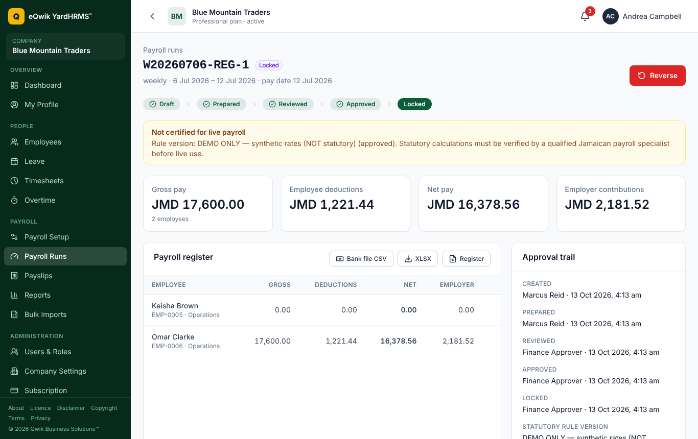

The run detail shows totals (gross, deductions, employer contributions, net), a line per employee and,
on each line, the earnings, statutory deductions with year-to-date figures, and the statutory rule
version used.

**Mistakes after approval.** Approved runs cannot be edited. Use **Reverse** on the run (creates a
reversal run that cancels it), then pay the correct amounts in a new regular or supplemental run.

## 10. Payslips

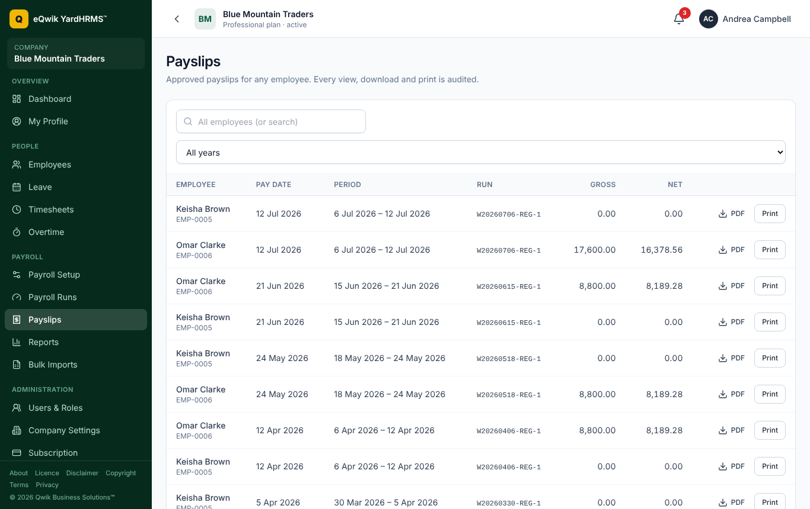

- **Employees** see their own payslips under *Payslips* (or *My Profile*) once a run is approved, and can
  view or download the PDF.
- **Administrators, Payroll Officers and Managers** with the print permission can search by employee and
  year, then view, download or print.
- **Every view, download and print is recorded** (who, which employee, when) and appears in the
  *Audit Log*.

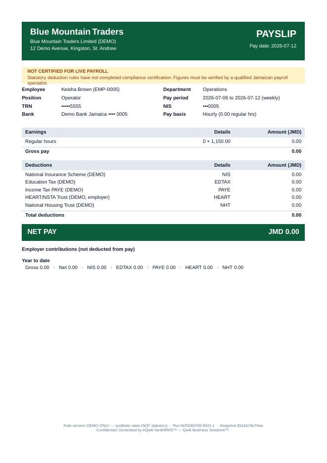

## 11. Reports, bulk imports and the audit log

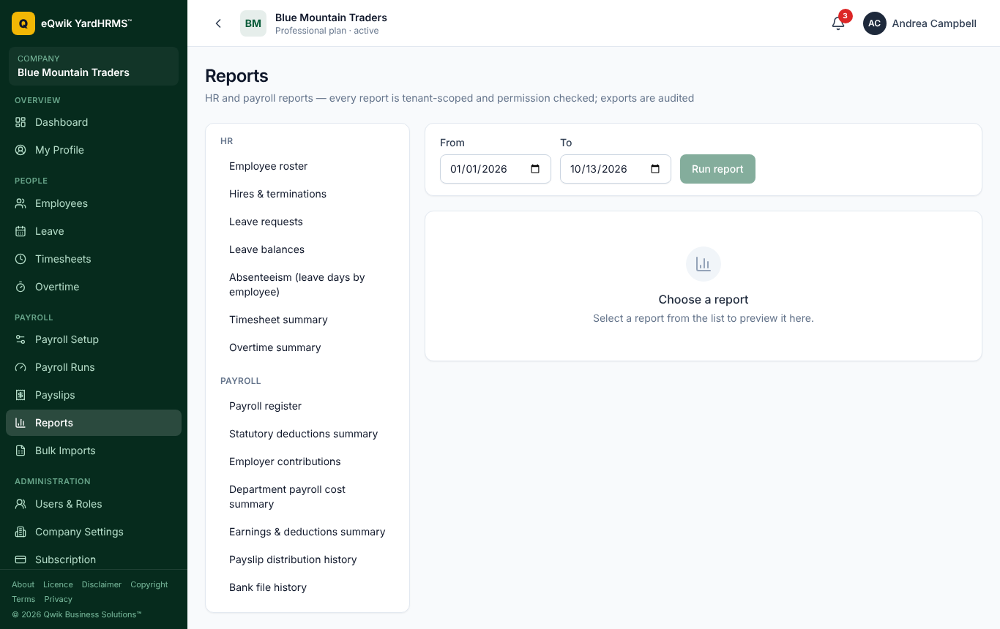

**Reports** — employee roster, hires and terminations, leave requests and balances, absenteeism,
timesheet and overtime summaries, payroll register, statutory summary, employer contributions,
department costs, earnings and deductions, payslip and bank-file history. Choose filters, preview, then
export to **CSV, XLSX or PDF**. Exports are recorded in the audit log.

**Bulk imports** (Professional and Business plans) — *Bulk Imports → New import*:

1. Choose the type (employees, timesheets, …) and **download the template**.
2. Fill it in and upload it (XLSX or CSV).
3. Check the column mapping and the preview, then **Execute**.
4. Every row ends as **Created, Updated, Rejected or Skipped** with a reason. Download the error file, fix
   the rejected rows and upload again — rows already imported are not duplicated.

For employees, a blank employee number creates a new employee and an existing number updates that
employee (blank cells keep existing values). Timesheet imports follow the same rules as manual entry.

**Audit log** (Professional and Business plans) — who did what and when, with before/after values for
changes. Filter by user, action, record or date. Nobody can edit or delete entries.

## 12. Users and roles

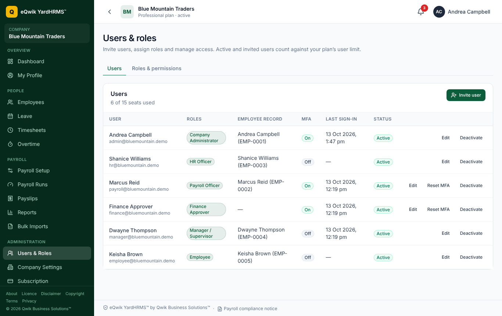

- **Invite a user** — *Users & Roles → Invite user*: email, name, role(s) and optionally the linked
  employee record. Invitations count against your user seats until accepted or cancelled.
- **Change roles** — open the user, adjust roles, save. Changes apply at once.
- **Custom roles** — *Roles → Custom role*, name it and pick permissions from the list.
- **Deactivate** — signs the user out immediately and frees the seat.
- **Reset MFA** — for a colleague who lost their phone: confirm who they are first (in person, or call
  back on a number you already have), record how you checked, then reset. They are signed out
  everywhere, get an email and set up a new authenticator at next sign-in. You cannot reset your own
  MFA; if they also belong to another company, contact Qwik support.

## 13. Subscription and billing documents

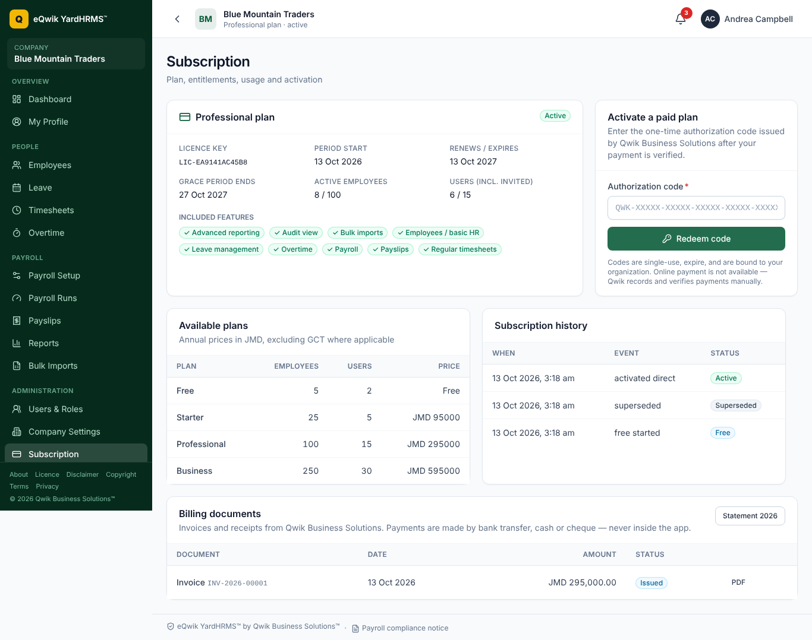

**Subscription** shows your plan, status, dates, features and usage against limits.

- **Upgrading or renewing.** Pay Qwik Business Solutions by bank transfer, cash or cheque, quoting your
  invoice number. When Qwik has verified the payment you either receive a **one-time activation code**
  (enter it on the *Subscription* page and choose **Redeem code**) or Qwik applies the plan directly. Renewals extend your
  current subscription — no new code.
- **Grace period.** When the paid period ends, a banner warns you for the plan's grace days; everything
  still works.
- **Expired or suspended.** The workspace becomes **read-only**: you can still view and export everything,
  including payslips, but cannot make changes until you renew. Nothing is deleted.
- **Downgrading** never deletes data. If you are over a lower plan's limits you cannot add or reactivate
  employees or users until you are within them.

**Billing documents** lists Qwik's invoices and receipts for your company (PDF) and a **statement** for
the year with your running balance.

## 14. Data & privacy

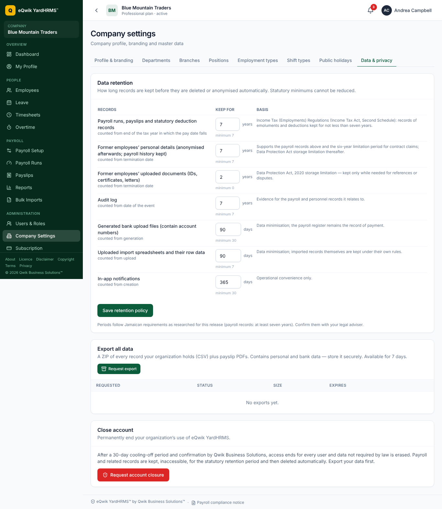

*Company Settings → Data & privacy* (Company Administrators):

- **Retention** — how long each kind of record is kept before automatic deletion or anonymisation.
  Payroll records, former employees' details and the audit log are kept for **at least seven years**;
  you can lengthen these periods but not shorten them below the minimum. Former employees are
  anonymised (name replaced, identifiers and contact details removed) while their payroll history is
  kept.
- **Export all data** — a ZIP with every record as CSV plus payslip PDFs, ready within minutes and
  downloadable for seven days. It contains TRN/NIS/NHT and bank numbers — store it securely.
- **Close account** — type the company name to confirm. Nothing happens for **30 days**, during which any
  administrator can cancel. Qwik then confirms the closure: access ends, data not required by law is
  erased, and payroll records are kept (inaccessible) until their retention period ends.

If you receive a request from an employee to see or correct their data, use the employee record and
reports to respond; the audit log shows who accessed or changed it.

## 15. Employee self-service quick guide

| I want to… | Go to |
|---|---|
| See my personal, employment and leave details | **My Profile** |
| Ask for leave / see my balance | **Leave → New leave request** / **Balances** |
| Enter my hours (weekly/fortnightly staff only) | **Timesheets → New timesheet** |
| Claim overtime | **Overtime → New overtime request** |
| View or download my payslip | **Payslips** |
| Change password, set up MFA, choose email notifications | User menu → **Account & security** |

You are notified (bell and email) when your requests are approved or rejected and when a new payslip is
available. Changes to your personal details, pay, bank details or identifiers are made by HR or Payroll — ask
them.

## 16. Manager quick guide

- **Approvals** — the bell, the *Pending approvals* tab on Leave and the pending items on Timesheets and
  Overtime list what is waiting for you. Approve or reject with a comment; use bulk approve for timesheets.
- **Entering for your team** — choose the employee in *New timesheet*, *New overtime request* or
  *New leave request*. Your entry still
  needs approval by someone else.
- **Payslips** — if your role allows, print payslips for your team from *Payslips*. Each print is
  recorded.

---

# Part B — Qwik Licence & Subscription Manager

The Licence Manager is a **separate application** for Qwik staff with its own address and sign-in. It
manages commercial records only and has **no access to companies' employee, leave, timesheet or payroll
data**.

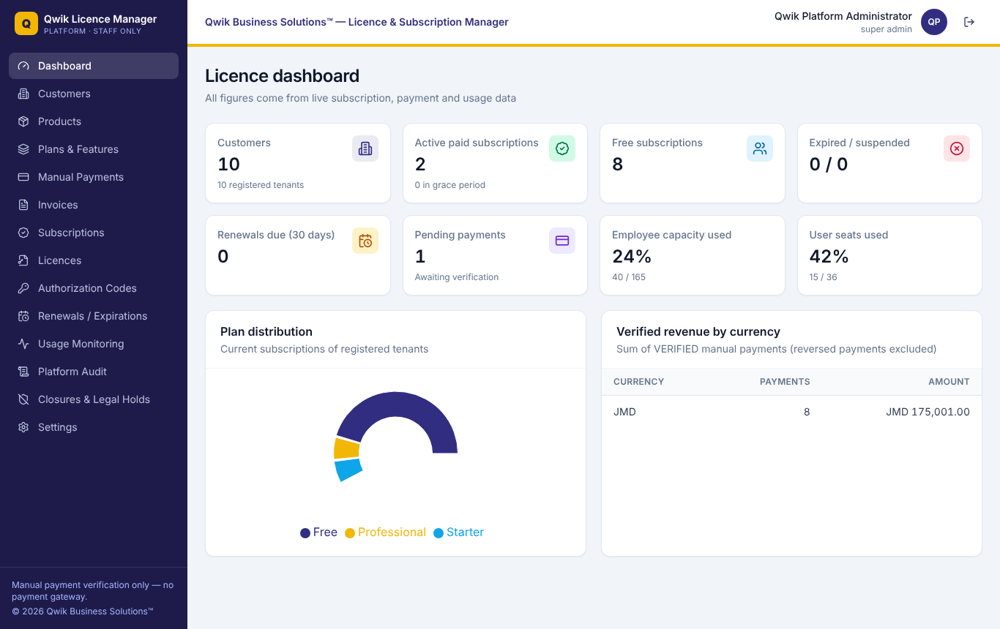

## 17. Signing in and roles

Sign in with your staff email and password; two-step verification is always required. New staff receive
a password-setup link.

| Role | Can |
|---|---|
| **Platform Super Admin** | Everything, plus products/plans/features, payment reversal, suspend/revoke/reinstate, code revocation, commercial overrides, staff management, account MFA resets, closures and legal holds |
| **Platform Licensing Officer** | Customers, invoices, record and verify payments, create/renew subscriptions, change plans and capacity, issue codes, usage, audit |

## 18. Plans and customers

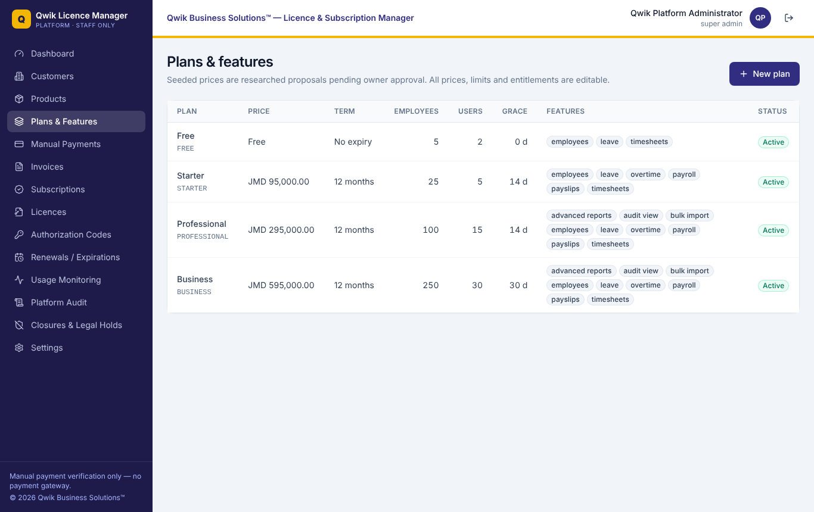

**Plans & Features** — each plan has a code, name, price and currency, duration in months, employee and
user limits, grace days, status and features (Employees, Leave, Timesheets, Overtime, Payroll, Payslips,
Bulk import, Advanced reports, Audit view). Changes apply to every company on the plan at its next check
and never delete data. Retire old plans instead of deleting them.

**Customers** — the paying party: name, contact, email, phone, address, TRN, notes, and the linked
company workspace. Companies that self-register already have a workspace on the Free plan; create or
link the customer record when they start buying. *Statement* gives the customer's year-to-date account.

## 19. Invoices and manual payments

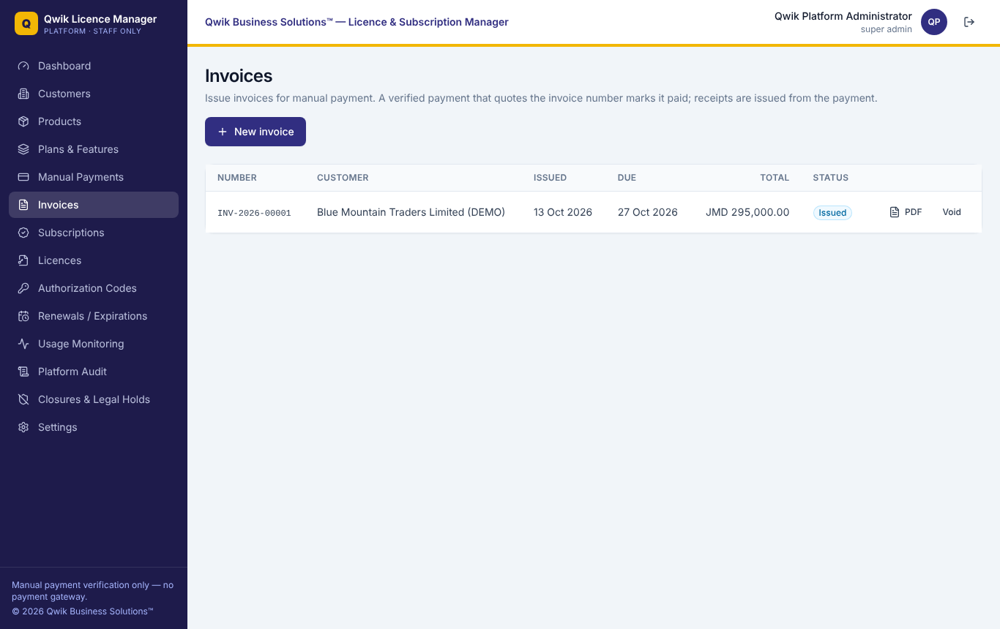

**Invoices → New invoice** — choose the customer and a plan (uses the plan price) or enter lines.
Numbers run `INV-YYYY-00001` without gaps; GCT is added only when Qwik is GCT-registered and the rate is
configured. Download the PDF and send it to the customer. Unpaid invoices can be voided with a reason
(the number is never reused); paid invoices cannot.

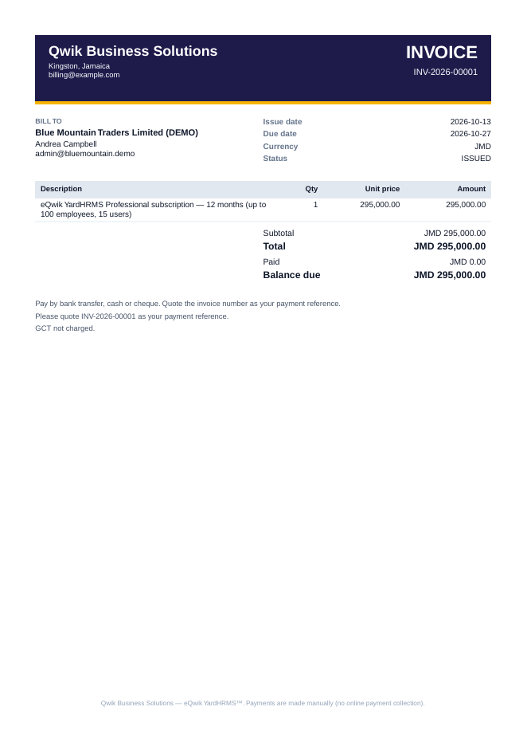

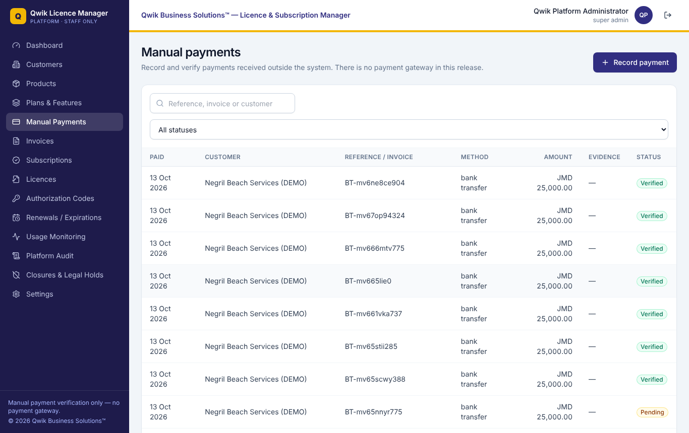

**There are no online payments.** Money arrives by bank transfer, cash or cheque.

1. **Record** — *Manual Payments → Record payment*: customer, plan, invoice number, reference, date,
   amount, currency, method, period covered, notes; attach evidence (bank slip, receipt scan).
2. **Verify** — a **different** officer confirms the money has arrived and verifies the payment (or
   rejects it with a reason). Verifying a payment that quotes an invoice marks the invoice **Paid**.
3. **Receipt PDF** — issues receipt `RCT-YYYY-00001` the first time; later downloads give the same
   receipt.
4. **Reverse** (Super Admin, e.g. bounced cheque) — with a reason. The invoice reopens and the receipt is
   marked REVERSED; decide separately whether to suspend the subscription it paid for.

A verified payment can fund **one** subscription activation or renewal.

## 20. Subscriptions, activation codes and renewals

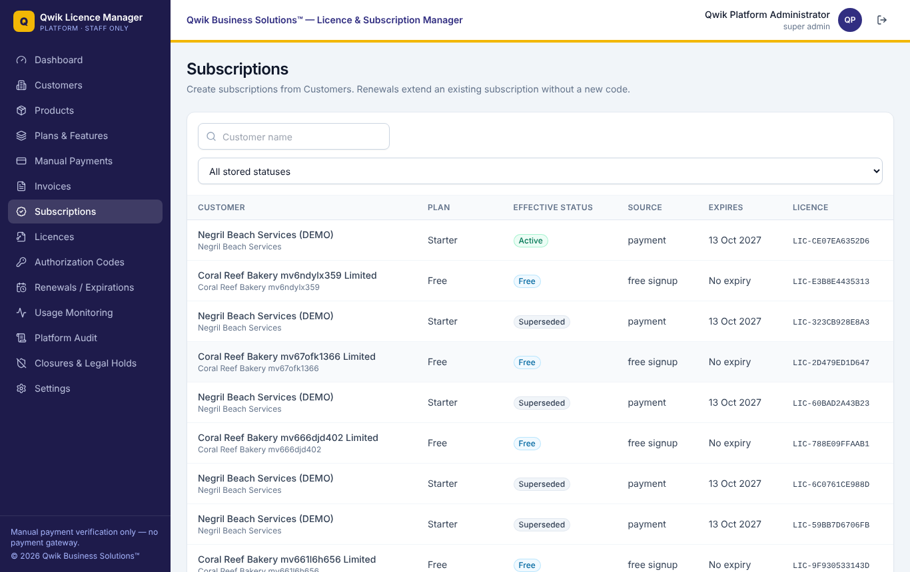

**New subscription** — customer, plan, the verified payment, optional capacity overrides, then either:

- **Issue an activation code** — shown **once**; copy it and send it to the company administrator through
  a trusted channel. The subscription waits as *Pending activation* until they redeem it. Codes are
  single-use, expire (default 30 days) and only work for that company. If one is lost, revoke it and
  issue a new one.
- **Apply directly** to the linked company — activates at once.

Without a verified payment only a Super Admin can proceed, with a written **commercial override** reason
(audited).

| State | What the company experiences |
|---|---|
| Free | Free limits and features |
| Pending activation | Paid plan bought, code not yet redeemed (stays on current plan) |
| Trial / Active | Full plan |
| Grace | Paid period over; still works, with a warning banner |
| Expired | Read-only until renewed |
| Suspended | Read-only (e.g. dispute, reversed payment); reinstate to restore |
| Revoked | Blocked except the subscription page; data kept; reinstate to restore |

The system moves subscriptions Active → Grace → Expired automatically and reminds company
administrators 30, 14, 7 and 1 day(s) before expiry. **No state ever deletes company data.**

**Renewals** — the *Renewals/Expirations* page is your follow-up queue (expiring in 30 days, in grace,
expired). Record and verify the renewal payment, then **Renew** on the subscription: the end date is
extended from the current end date (or today, if already expired). No new code is needed.

**Change plan** and **Adjust capacity** — with a reason. Downgrades below current usage do not remove
anything; the company just cannot add more until it is within the limits.

**Suspend / Revoke / Reinstate** — Super Admin only, with a reason.

## 21. Usage, audit, staff and account support

- **Usage Monitoring** — active employees and users against limits per company (counts only, no personal
  data).
- **Licences** and **Authorization Codes** — current entitlements and the history of issued, redeemed,
  expired and revoked codes (never the code itself).
- **Platform Audit** — every payment, subscription, code, override, staff and MFA-reset action.
- **Settings → Staff** — add staff, change roles, remove access (at least one Super Admin must remain).
- **Settings → Reset an account's MFA** — for a company's only administrator or a staff member who lost
  their authenticator. Verify identity out of band first and record how; the person is signed out
  everywhere and notified by email.

## 22. Account closures and legal holds

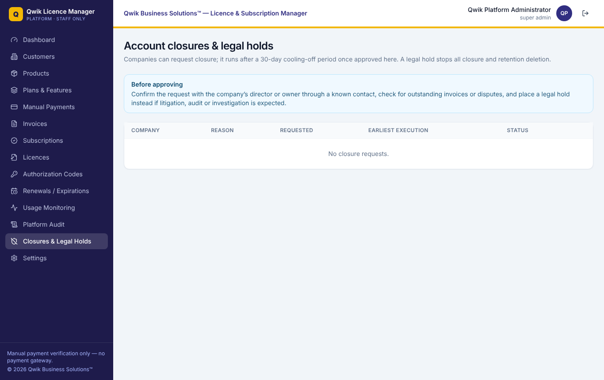

*Closures & Legal Holds* (Super Admin) lists closure requests from companies. Before approving, confirm
the request with the company's director through a contact you already hold and check for disputes or
unpaid invoices. The closure executes after the 30-day cooling-off period.

A **legal hold** (with a reason) stops all retention deletion and closure for that company until lifted —
use it for litigation, tax audits or investigations.

---

## Glossary

| Term | Meaning |
|---|---|
| **Activation code** | One-time code from Qwik that switches a company to a paid plan |
| **Cumulative (YTD) method** | Statutory deduction calculated on year-to-date income less deductions already taken, so the year's total is right even if pay varies |
| **Grace period** | Days after a paid period ends during which the workspace still works |
| **Lock** | Closing a payroll period so its time and leave records cannot change |
| **Reference pack** | Researched statutory figures imported as a draft rule version for verification and approval |
| **Reversal run** | A payroll run that cancels an approved run; corrections are then paid in a new run |
| **Supplemental run** | An extra payroll run for bonuses, commission, retro pay or adjustments |
| **Statutory income** | Gross taxable pay after NIS and approved pension contributions, the base for PAYE and Education Tax |

## Getting help

- **Inside your company** — your Company Administrator manages users, roles, settings and MFA resets.
- **Qwik support** — subscriptions, payments, invoices, activation codes, an only-administrator MFA reset,
  data or closure questions.
- **Technical staff** — see the [setup & deployment guide](setup-deployment-guide.md).
